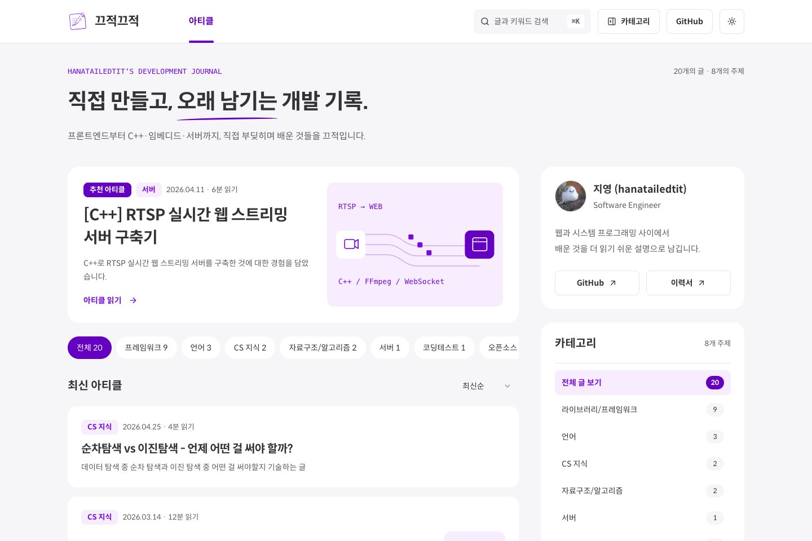
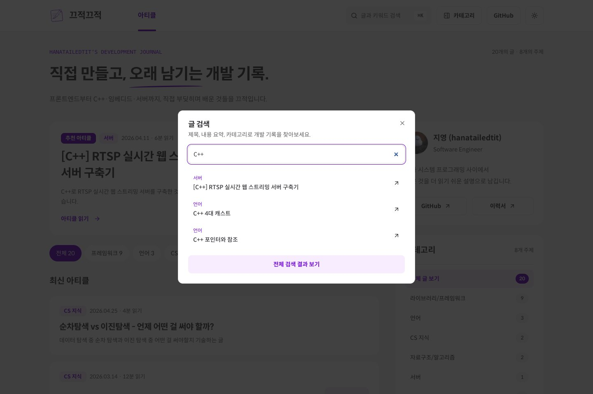
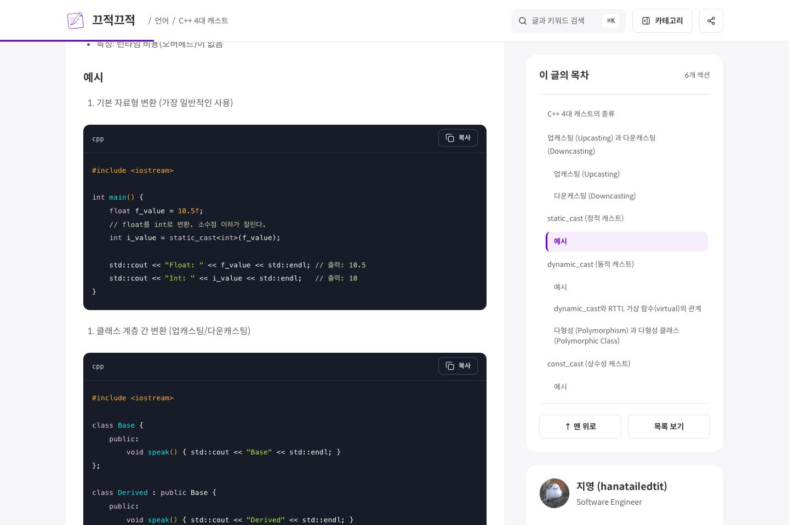
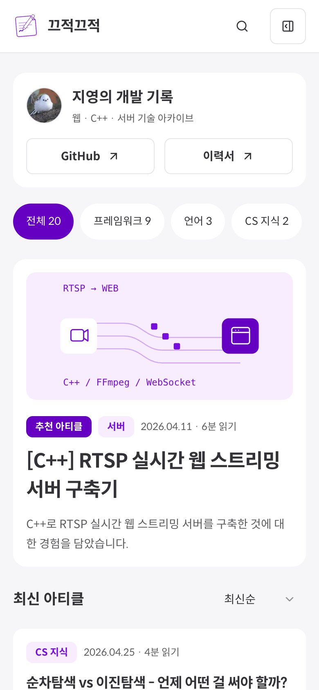
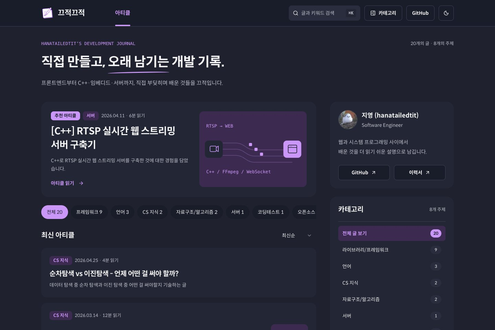
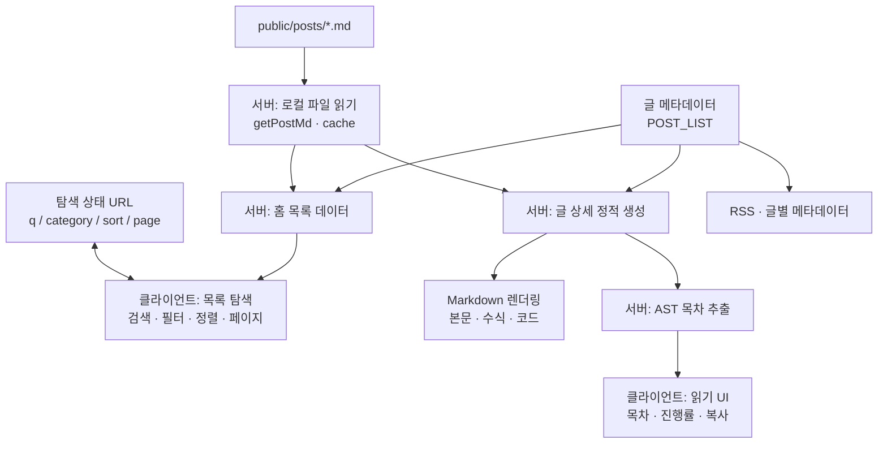

# 끄적끄적 · CreateDoodle

**직접 만들고, 오래 남기는 개발 기록.**

프론트엔드부터 C++·임베디드까지의 개발 경험을 모으는 개인 기술 블로그입니다. Markdown으로 글을 관리하면서도, 독자는 검색과 카테고리로 글을 찾고 목차와 읽기 진행률을 통해 긴 문서를 읽을 수 있도록 만들었습니다.

기획, 와이어프레임, UI/UX 디자인, 프론트엔드 구현과 배포를 맡은 **1인 프로젝트**입니다. 현재 20개의 글과 8개 주제를 제공하며, Next.js App Router와 로컬 Markdown을 기반으로 운영합니다.

[서비스 바로가기](https://blog.createdoodle.dev/) · [글 상세 예시](https://blog.createdoodle.dev/post/17) · [RSS](https://blog.createdoodle.dev/rss.xml)



## 구현에서 집중한 점

| 해결하려던 문제                                             | 구현 방식                                                                       | 코드                                                                                     |
| ----------------------------------------------------------- | ------------------------------------------------------------------------------- | ---------------------------------------------------------------------------------------- |
| 검색·필터 후 새로고침하거나 뒤로 가면 탐색 맥락을 잃는 문제 | 검색어·카테고리·정렬·페이지를 URL로 관리하고 목록 계산을 순수 함수로 분리       | [usePost](src/hooks/usePost.ts), [getPostPage](src/utils/posts.utils.ts)                 |
| 코드 예제 속 `##`나 중복 제목 때문에 잘못 생성되는 목차     | Markdown AST에서 실제 제목만 추출하고, 원문 행 번호로 목차와 본문의 앵커를 연결 | [목차 추출](src/utils/markdown.utils.ts), [본문 렌더러](src/components/posts/MdPost.tsx) |
| 개인 블로그에 별도 DB·CMS를 운영해야 하는 부담              | 저장소의 Markdown을 직접 읽고 글 상세 경로를 빌드 시 정적 생성                  | [파일 로더](src/api/post.api.ts), [글 상세 페이지](src/app/post/[id]/page.tsx)           |
| 화면마다 다른 스타일과 키보드 조작 방식                     | shadcn/ui·Radix UI를 바탕으로 공통 컴포넌트와 색상 토큰을 구성                  | [UI 컴포넌트](src/components/ui), [전역 스타일](src/app/globals.css)                     |

## 주요 사용자 흐름

| 탐색                               | 읽기                               | 재방문·공유                       |
| ---------------------------------- | ---------------------------------- | --------------------------------- |
| 추천 글과 카테고리별 글 목록       | GFM 표·수식·코드 문법 강조         | 글별 OpenGraph·Twitter 메타데이터 |
| `⌘K` / `Ctrl+K` 검색 다이얼로그    | 스크롤 위치와 연동되는 목차·진행률 | URL 공유·코드 복사                |
| 최신순·오래된순 정렬, 페이지네이션 | 예상 읽기 시간, 이전·다음 글 이동  | RSS, 저장되는 라이트·다크 테마    |

검색은 **제목·요약·카테고리·하위 카테고리**를 대상으로 합니다. 카테고리 버튼은 현재 페이지 위에 탐색 패널을 열고, 항목을 선택하면 목록을 필터링합니다.

<details>
<summary>실제 서비스 화면 더 보기 — 검색 · 본문 · 모바일 · 다크 모드</summary>

### 검색



### 글 상세



### 모바일 · 다크 모드





</details>

화면은 2026-10-28 배포 서비스에서 캡처했습니다. 데스크톱은 1440×960, 모바일은 390×844 CSS px 기준입니다.

## 설계와 구현 판단

### 1. 콘텐츠 처리와 브라우저 상호작용의 역할 분리

글 본문은 `public/posts/<id>.md`, 제목·날짜·카테고리 등은 `POST_LIST`에서 관리합니다. 서버에서 Node.js 파일 시스템으로 본문을 읽기 때문에, 배포된 자신의 URL을 다시 호출해 Markdown을 가져올 필요가 없습니다. 파일 로더는 숫자 ID만 허용하고 React `cache`로 동일 요청의 중복 로드를 줄입니다.

글 상세는 `generateStaticParams`로 경로를 만들고, 서버 컴포넌트에서 Markdown과 코드 블록을 렌더링합니다. 목차의 활성 상태, 읽기 진행률, 복사처럼 브라우저 API가 필요한 부분은 클라이언트 컴포넌트로 분리했습니다. 홈은 서버에서 읽기 시간을 포함한 목록 데이터를 준비하고, 클라이언트에서 URL에 따라 탐색 상태를 계산합니다.



개인 작성자가 Git으로 글을 관리하는 서비스에 맞춘 선택입니다. 별도 DB·관리자 화면이 필요 없는 대신, 글을 추가하거나 수정하면 다시 빌드·배포해야 합니다.

### 2. URL을 기준으로 일관되게 동작하는 목록

`/?category=language&q=c%2B%2B&sort=oldest&page=0`처럼 탐색 상태를 공유할 수 있습니다. `usePost`는 URL 변경을 담당하고, `getPostPage`는 필터링 → 정렬 → 추천 글 제외 → 페이지 계산을 담당합니다.

- 카테고리나 정렬을 바꾸면 페이지를 초기화해 이전 페이지 번호 때문에 빈 목록이 보이지 않도록 했습니다.
- 추천 글은 기본 목록 상단에 따로 노출하고, 페이지 목록에서는 제외해 중복을 막았습니다.
- 잘못된 카테고리는 전체 목록으로, 음수·숫자가 아닌 페이지는 첫 페이지로 보정합니다. 마지막 페이지를 넘으면 유효 범위로 제한합니다.
- 검색 결과가 없을 때는 빈 상태를 표시하며, 필터·정렬 과정에서 원본 목록을 변경하지 않습니다.

이 계산은 React 밖에서 테스트할 수 있어 경계 조건을 [단위 테스트](tests/posts.test.ts)로 검증합니다. URL의 `page`는 0부터 시작하며 페이지당 글은 5개입니다.

### 3. Markdown 구조를 기준으로 연결하는 목차

단순 문자열 검색으로 제목을 찾으면 코드 블록 속 제목을 잘못 포함하거나 같은 제목의 앵커가 충돌할 수 있습니다. `mdast-util-from-markdown`으로 AST를 만들고 실제 H2·H3만 추출했습니다. 강조·인라인 코드 안의 텍스트도 제목에 포함합니다.

목차와 본문 렌더러가 같은 `headingId(원문 행 번호)`를 사용해 동일한 제목에도 서로 다른 앵커를 부여합니다. `IntersectionObserver`로 현재 읽는 섹션을 표시하고, 모바일에서는 접을 수 있는 목차를 제공합니다.

[읽기 진행률](src/components/posts/ReadingProgress.tsx)은 passive 스크롤 리스너와 `requestAnimationFrame`을 사용하고, 이벤트·예약 프레임을 정리합니다. 스크롤할 공간이 없는 짧은 문서도 처리합니다. 읽기 시간은 본문 길이를 분당 약 500자로 환산한 추정치이며 최소 1분으로 표시합니다.

### 4. 재사용 가능한 UI와 읽기 환경

Button·Card·Badge·Dialog·Sheet·Select를 공통 컴포넌트로 구성하고, Tailwind CSS의 의미 기반 색상 토큰으로 라이트·다크 테마를 적용했습니다. Spoqa Han Sans Neo는 `next/font/local`로 불러옵니다.

검색 단축키, Escape 닫기와 포커스 복원, 본문 건너뛰기 링크, 포커스 표시, `prefers-reduced-motion` 대응을 적용했습니다. 표와 코드는 컨테이너 안에서 가로 스크롤하도록 구성했습니다. 테마 선택은 `localStorage`에 저장하고 첫 화면 렌더링 전에 복원합니다.

## 기술 스택

| 영역       | 사용 기술과 용도                                                                                   |
| ---------- | -------------------------------------------------------------------------------------------------- |
| 프레임워크 | Next.js 14 App Router, React 18, TypeScript 5 — 라우팅, 서버·클라이언트 컴포넌트                   |
| UI         | Tailwind CSS 3, shadcn/ui, Radix UI, SCSS — 공통 컴포넌트와 스타일                                 |
| 콘텐츠     | react-markdown, remark-gfm, remark-math, rehype-katex, react-syntax-highlighter — 기술 문서 렌더링 |
| 파싱       | mdast-util-from-markdown — AST 기반 목차 추출                                                      |
| 검증·배포  | Node.js Test Runner, TypeScript, ESLint, Vercel                                                    |

## 검증

2026-10-28 기준, 로컬 코드 검사와 배포 서비스의 브라우저 검사를 구분해 확인했습니다.

| 검사                             | 결과·범위                                                                                                       |
| -------------------------------- | --------------------------------------------------------------------------------------------------------------- |
| `yarn test`                      | 5개 통과: 추천 글 중복 방지, 필터·정렬 조합과 원본 보존, 잘못된 입력·빈 결과, 목차 파싱, 읽기 시간              |
| `yarn tsc --noEmit`              | 통과                                                                                                            |
| `yarn lint`                      | 오류 없음. 기존 `ProfileImage.tsx`의 `no-img-element` 경고 1건                                                  |
| 배포 서비스의 Chromium 동작 검사 | 페이지 이동·필터 후 페이지 초기화·뒤로 가기, 검색과 빈 상태, 패널 포커스 복원, 목차 앵커·진행률, 테마 저장 확인 |
| 반응형 레이아웃                  | 375 / 390 / 768 / 1024 / 1440px에서 홈·글 상세의 문서 가로 넘침 없음                                            |
| axe 접근성 자동 검사             | 홈·검색·카테고리 패널·다크 홈에서 위반 없음. 글 상세에서 코드 스크롤 영역의 키보드 포커스 항목 1건 발견         |

브라우저 확인은 배포 서비스에 대한 일회성 Playwright·axe 검사이며, 저장소의 `yarn test`나 CI에 통합된 E2E 테스트는 아닙니다. 세부 결과와 캡처 출처는 [브라우저 검사 기록](docs/verification/browser-checks.json)에 남겼습니다. 자동 검사 결과는 접근성 전체 준수를 의미하지 않습니다.

이번 문서 갱신에서는 프로덕션 빌드를 다시 실행하지 않았습니다. 실제 모바일 기기, Safari·Firefox, 네이티브 공유 시트·클립보드 권한별 동작, 성능·트래픽 지표는 확인하지 않았습니다.

## 로컬 실행

Node.js **22.18 이상**과 Yarn Classic 1.x를 사용합니다. 테스트는 Node.js의 TypeScript 실행 기능을 사용합니다.

```bash
yarn install --frozen-lockfile
yarn dev
```

개발 서버 주소는 `http://localhost:3001`입니다. 메타데이터와 RSS의 기준 주소가 필요하면 `.env.local`을 설정합니다. Markdown 본문을 읽는 데 외부 서비스 연결은 필요하지 않습니다.

```dotenv
# 로컬 환경
NEXT_PUBLIC_CLIENT_URL=http://localhost:3001
```

배포 환경에서는 `NEXT_PUBLIC_CLIENT_URL=https://blog.createdoodle.dev`로 설정합니다. 설정하지 않으면 [SITE 상수](src/constants/site.constants.ts)의 기본 주소를 사용합니다.

```bash
yarn test          # 목록·목차·읽기 시간 단위 테스트
yarn tsc --noEmit  # 타입 검사
yarn lint         # 정적 분석
yarn build        # 프로덕션 빌드
yarn start        # 빌드 결과 실행
```

## 콘텐츠와 코드 구조

```text
public/
├── posts/                # 글 본문 Markdown
├── fonts/                # 로컬 웹폰트와 라이선스
└── brand/                # 메모·연필 브랜드 에셋
src/
├── app/                  # 홈, 글 상세, RSS, 공통 레이아웃
├── api/                  # 서버의 로컬 Markdown 로더
├── components/
│   ├── ui/               # shadcn/ui 기반 공통 컴포넌트
│   ├── home/             # 홈과 목록 탐색 UI
│   └── posts/            # 본문, 코드 블록, 목차, 진행률
├── constants/            # 글 목록, 카테고리, 사이트 설정
├── hooks/                # URL과 연결하는 목록 탐색 훅
└── utils/                # 목록 계산, 목차 파싱, 공통 유틸리티
tests/posts.test.ts       # 핵심 로직과 경계 조건 검증
docs/                    # 실제 서비스 캡처와 검사 기록
```

글을 추가하려면 `public/posts/<id>.md`를 작성하고 [POST_LIST](src/constants/post-list.constants.ts)에 같은 ID의 메타데이터를 등록합니다. 새 주제라면 [CATEGORY_LIST](src/constants/category.constants.ts)도 갱신한 뒤 검사와 빌드·배포를 진행합니다.

Markdown은 저장소에서 관리하는 신뢰된 콘텐츠를 전제로 하며 HTML 렌더링을 허용합니다. 외부 사용자가 문서를 업로드하는 서비스로 확장한다면 별도의 콘텐츠 검증·정제 단계가 필요합니다. 현재 검색은 메타데이터 기반으로, 본문 전체 검색은 제공하지 않습니다.

## 개발 이력

Git 커밋으로 확인할 수 있는 주요 변경입니다.

| 시기    | 변경 내용                                                                   | 관련 커밋                                                                                                                                                    |
| ------- | --------------------------------------------------------------------------- | ------------------------------------------------------------------------------------------------------------------------------------------------------------ |
| 2024.03 | Next.js 프로젝트 초기 구성, 글 목록과 Markdown 렌더러 구현                  | [초기 렌더러](https://github.com/hanatailedtit/createdoodle-next/commit/055b08e)                                                                             |
| 2024.09 | 글 상세 경로·헤더 구성, 본문 스타일·수식·이미지 경로 보완                   | [상세 페이지](https://github.com/hanatailedtit/createdoodle-next/commit/9a5749a), [KaTeX](https://github.com/hanatailedtit/createdoodle-next/commit/ace0077) |
| 2026.10 | 반응형 UI 전면 개편, 탐색·읽기 기능과 공통 컴포넌트·브랜드 에셋·테스트 추가 | [UI 개편](https://github.com/hanatailedtit/createdoodle-next/commit/6b8195c)                                                                                 |
